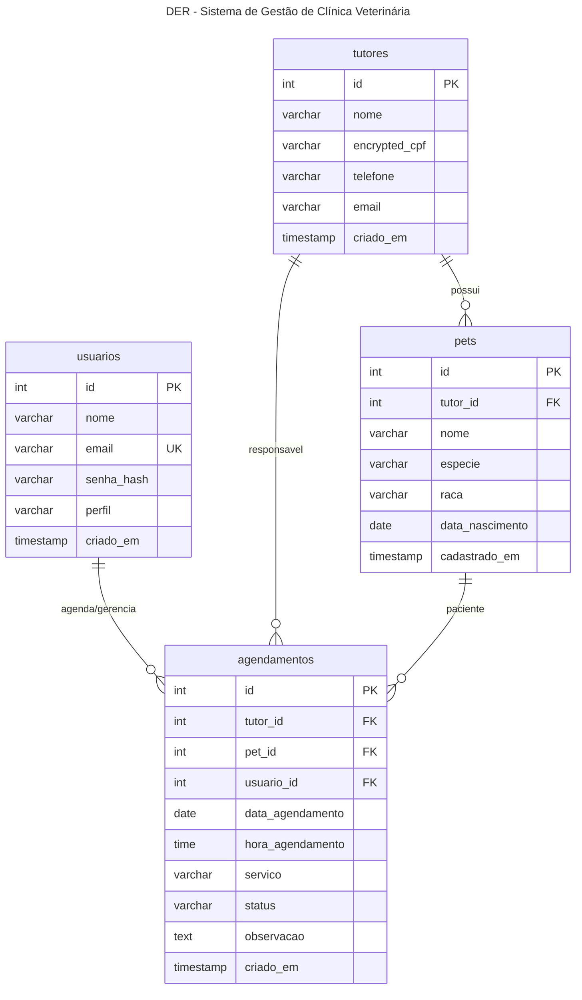

# Resolução do Desafio Pratico SAEP 2026 - Prova 1 **Software para Gestão de Clínica Veterinária**

### **Tecnologias**: PHP 8.5.9, PostgreSQL, PDO (Prepared Statements)

### **Arquitetura**: public-src, MVC, Autoload PSR-4 via composer

---

## Apresentação e Visão Geral

Este README.md tem a finalidade de apresentar a documentação integral do projeto **Software para Gestão de Clínica Veterinária** e o Diagrama de Entidades e Relacionamento (DER). Seguindo à risca os critérios estabelecidos na **Prova Prática 1 SAEP 2026**.

- Segurança LGPD;
- Min. 3 registros para cada tabela do banco de dados;
- Sessão com tempo de expiração (padrão 15 min.);
- Código limpo e princípio SOLID;
- Uso de Credenciais;
- Prevenção anti-vulnerabilidades.

## Entregas

link do github do projeto, contendo:
- Documentação e DER (README.md);
- Script de criação e população do banco de dados (saep_db1.sql);
- Sistema MVC com página inicial (home), funcionalidade de login, gerenciamento de tutores, pets e agendamentos (dentro de sistema/src/);

### Identificação do Projeto
- **Nome do Sistema:** VetCore - Sistema de Gestão de Clínica Veterinária
- **Público-Alvo**: Veterinários, Recepcionista e Gestores da Clínica
- **Problema**: Eliminação dos controles manuais, duplicidade de registro, perda de agendamentos, risco de vazamentos de dados(LGPD)

### Requisitos Funcionais (RF)

- **RF-01:** Login com validação em caso de falha na autenticação;
- **RF-02:** CPF dos tutores criptografado para armazenar no banco de dados;
- **RF-03:** A página principal (home) deve mostrar o nome do usuário logado e ter formas de acessar os demais recursos ou sair do sistema (logout);
- **RF-04:** Ter recurso de busca por termo, com filtragem automática pós-confirmação. Além de permitir editar os dados de um tutor já cadastrado e salvar no banco;
- **RF-05:** Permitir listagem dos agendamentos cadastrados, ordenados por dia de agendamento (com os dados do tutor e seu pet). Além de permitir editar a data de um agendamento já cadastrado e salvar no banco;
- **RF-06:** Todo pet deve ser associado a um tutor.

### Diagrama de Entidades Relacionais (DER)

